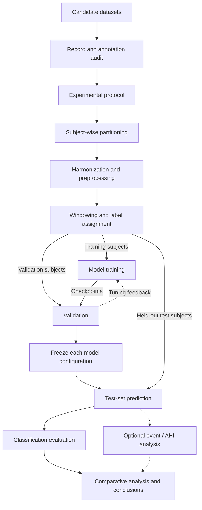

# Konteks Penelitian Sleep Apnea Multimodal

Versi: 18 November 2026. Acuan: paper progres yang dikumpulkan pada UTS.

## 1. Tujuan dokumen dan aturan acuan

Dokumen ini adalah konteks kerja untuk AI dan anggota kelompok ketika melanjutkan penulisan, audit data, implementasi, dan evaluasi. Dokumen ini diperbarui dari konteks 9 November 2026 agar sesuai dengan `paper RM (1).pdf` yang diberikan pengguna sebagai versi UTS.

**Acuan utama saat ini adalah paper UTS tersebut.** Draft lama, percakapan, slide, dan rekomendasi AI sebelumnya tidak boleh mengganti metode yang sudah tertulis pada paper ini secara diam-diam. Dokumen konteks ini tidak mengubah PDF sumber.

Urutan penggunaan acuan:

1. Arahan eksplisit terbaru pengguna untuk perubahan lingkup.
2. Paper UTS untuk rancangan penelitian yang saat ini diserahkan.
3. Dokumentasi/berkas dataset asli untuk fakta kanal, subjek, sampling rate, dan anotasi.
4. Konfigurasi, kode, log, dan prediksi aktual untuk status implementasi serta hasil.
5. Materi lama hanya sebagai riwayat jika tidak bertentangan dengan poin di atas.

Jika paper mengandung ketidakjelasan, tuliskan masalahnya dan keputusan yang diperlukan. Jangan menganggap kesalahan atau kalimat ambigu sebagai instruksi implementasi yang sudah pasti benar. Pisahkan isi paper, batas interpretasi, usulan, dan hasil aktual.

Penanda status:

| Penanda | Arti |
| --- | --- |
| RENCANA PAPER | Sudah tertulis sebagai metode yang akan digunakan, belum membuktikan sudah dijalankan |
| OPSIONAL PAPER | Pilihan bersyarat yang disebut paper, bukan eksperimen utama wajib |
| TBD | Nilai/detail belum ditetapkan dalam paper |
| PERLU KLARIFIKASI | Ada ketidakjelasan yang memengaruhi implementasi atau interpretasi |
| HASIL AKTUAL | Hanya dipakai jika tersedia bukti eksekusi dan keluaran yang dapat ditelusuri |

## 2. Identitas, tujuan, dan status riset

Judul persis pada paper:

> Multimodal Sleep Apnea Detection Using ECG and Respiratory Signals with Multi-Dataset Harmonization and Reduced Temporal Windowing

Anggota: Muhammad Fariz Rayhan Ramadhan, Muhammad Fatih Rafa Raditya Hasan, dan Raden Reyski Azka Rakhmadya. Afiliasi: School of Computer Science, BINUS University, Bekasi, Indonesia. Konteks: Research Methodology in Computer Science.

Tujuan riset: mengembangkan dan mengevaluasi pipeline multimodal yang membaca waveform ECG dan respirasi, kemudian mengklasifikasikan setiap window sebagai apnea atau normal. Evaluasi mencakup fusion, durasi input, preprocessing, dan training pada beberapa dataset yang diharmonisasikan.

Empat fokus:

- Perbandingan Multimodal Cross-Attention Transformer dengan ECG-only, respiration-only, dan simple fusion.
- Input 10 detik dibandingkan 30 detik.
- Kontribusi filtering, normalization, dan amplitude clipping melalui ablation.
- Harmonisasi serta konfigurasi single-dataset/combined-dataset training, dengan evaluasi lintas dataset yang bersyarat.

Status berdasarkan PDF:

- Tersedia Introduction, Related Work, Research Methodology, flowchart, serta daftar pustaka bernomor [1]–[45].
- Belum terdapat Results, hasil training kelompok, manifest split final, atau angka evaluasi model kelompok dalam PDF.
- Angka performa publikasi terdahulu adalah hasil publikasi tersebut, bukan hasil proyek ini.
- Dataset final, jumlah subjek/rekaman lolos, parameter numerik, dan rincian eksekusi belum dapat dianggap selesai.
- Tidak ada dasar untuk menyatakan model sudah terbukti unggul, dapat dipakai klinis, atau pasti lebih efisien.

## 3. Research design dan posisi kontribusi

Section 3.1 menetapkan rancangan **quantitative experimental**, dengan comparative experiments dan ablation. Klasifikasi sebagai applied research merupakan penjelasan yang sesuai tujuan praktis proyek, tetapi istilah tersebut tidak perlu dianggap kutipan eksplisit Section 3.1.

Kontribusi yang direncanakan adalah evaluasi empiris beberapa pilihan metodologis dalam satu pipeline. Jangan mengklaim bahwa multimodal fusion, Transformer, atau cross-attention belum pernah ada.

Variabel menurut Section 3.1:

- Independent: konfigurasi model, durasi window, dan pengaturan preprocessing. Konfigurasi training dataset dibahas dalam Experiment 4.
- Dependent: accuracy, sensitivity, specificity, precision, F1-score, dan ROC-AUC.
- Controlled: partisi subjek, optimizer, training budget, batch size, aturan tuning learning rate, labeling strategy, protokol evaluasi, dan seed yang dipasangkan antarkonfigurasi.

Introduction menjelaskan tujuan serta empat fokus, tetapi tidak merumuskan RQ1–RQ4 dan H1–H4 secara eksplisit. Jangan memasukkan hipotesis dari slide sebelumnya sebagai isi resmi paper UTS. Jika diminta menyusunnya, tandai sebagai usulan penyelarasan, bukan kutipan atau keputusan lama yang sudah disahkan.

## 4. Empat kelompok eksperimen yang menjadi acuan

| Eksperimen | RENCANA PAPER | Kendali dan batas interpretasi |
| --- | --- | --- |
| 1. Modality and fusion | Proposed vs ECG-only, respiratory-only, simple fusion | Encoder design, training budget, dan split dibuat sama; catat kapasitas/parameter tiap model |
| 2. Temporal window duration | 10 s sebagai reduced-window utama; 30 s sebagai pembanding lebih panjang | Partisi, pemrosesan, model, dan aturan label yang kompatibel dijaga konsisten |
| 3. Preprocessing ablation | Filtering, normalization, clipping ditambah/dihapus satu per satu | Paper belum memberi daftar konfigurasi ablation lengkap; jangan mengubahnya menjadi semua kombinasi secara otomatis |
| 4. Multi-dataset harmonization | Single-dataset training dengan held-out subjects dari dataset yang sama; combined-dataset training dengan held-out subjects dari semua dataset | Ketersediaan dan kompatibilitas data harus lolos audit; pemilihan cohort/target pembanding harus dilaporkan |

Leave-one-dataset-out (LODO) adalah OPSIONAL PAPER jika kompatibilitas memungkinkan. Satu dataset seluruhnya ditahan dari training dan digunakan untuk test. Laporkan terpisah dari subject-level holdout utama.

Batas interpretasi Experiment 4: penggabungan dataset juga mengubah ukuran dan komposisi training cohort. Hasilnya tidak otomatis mengisolasi efek harmonisasi murni. Jangan mengganti eksperimen resmi menjadi “tanpa vs dengan harmonisasi”, atau menambahkan domain adaptation, tanpa keputusan revisi yang jelas. Untuk perbandingan langsung, identifikasi subjek test target yang sebanding dan catat perubahan cohort.

Empat kelompok eksperimen bukan berarti hanya empat training run. Jumlah run, seed, kombinasi durasi, dan ablation masih TBD. Jangan memperbesar matriks eksperimen menjadi seluruh perkalian semua pilihan tanpa kebutuhan untuk menjawab fokus riset.

## 5. Flowchart dan alur kerja versi UTS

**Flowchart pada halaman PDF 4 menggantikan acuan gambar lama untuk konteks versi ini.** Paper ini memuat kotak `Experimental protocol` dan `Freeze each model configuration`. Larangan pada konteks lama untuk menambahkan kedua kotak tersebut tidak berlaku sebagai deskripsi paper UTS.

Urutan pada Section 3.2 dan gambar:

1. UCDDB, MIT-BIH PSG, Apnea-ECG sebagai sumber kandidat.
2. Record and annotation audit: eligibility, subject mapping, channel availability.
3. Experimental protocol: target definition, channel policy, ablation configurations.
4. Subject-wise data partitioning: training, validation, dan test dengan subjek terpisah.
5. Harmonization and preprocessing: fit learned parameters pada training, terapkan pada semua partisi.
6. Windowing and label assignment: konfigurasi input 10 s dan 30 s.
7. Model training dan validation sebagai bagian terpisah: checkpoints menuju validation, tuning feedback kembali ke training.
8. Freeze each model configuration: arsitektur, checkpoint, dan decision threshold.
9. Test-set prediction dengan frozen models pada held-out subjects.
10. Classification evaluation. Prediksi juga dapat masuk cabang Optional event / AHI analysis.
11. Comparative analysis and conclusions.

Data test bercabang setelah windowing dan langsung menuju test-set prediction. Data tersebut tidak menjadi masukan training atau tuning. Diagram inti berikut merangkum topologinya; rincian model tetap mengacu pada Section 3.4.



Jangan memindahkan harmonisasi ke depan split. “Record audit” adalah pemeriksaan data; “validation” adalah pemilihan model menggunakan partisi validation. Keduanya bukan tahap yang sama.

Riwayat preferensi satu gambar gabungan metodologi–arsitektur tidak berarti gambar UTS sudah menampilkan seluruh encoder. Gambar UTS adalah alur penelitian; arsitektur rinci ada dalam teks. Jika pengguna meminta revisi gambar, nyatakan hubungan dengan gambar UTS dan jangan menggantinya secara diam-diam.

## 6. Dataset dan audit yang diperlukan

Section 3.3 mempertimbangkan tiga database dari **PhysioNet**:

| Dataset dalam paper | Peran saat ini |
| --- | --- |
| UCDDB / University College Dublin Sleep Apnea Database | Kandidat ECG + respirasi; cek rekaman, kanal, anotasi, sinkronisasi |
| MIT-BIH Polysomnographic Database | Kandidat ECG + respirasi; audit subjek dan resolusi anotasi |
| Apnea-ECG Database | Gunakan bagian yang benar-benar mendukung pasangan ECG–respirasi; jangan menganggap seluruh database memenuhi syarat |

Paper tidak menetapkan jumlah final rekaman/subjek atau sampling rate target. Jangan mengisi jumlah akhir dengan angka 51 dari overview lama, menjumlahkan seluruh katalog, atau menganggap semua record ID adalah subjek unik.

Audit dalam paper mencakup eligibility, subject information, channel availability, annotation structure, dan signal quality. Paper menyebut tabel audit yang akan diisi, tetapi tabel tersebut tidak tampak sebagai tabel terisi pada bagian dataset PDF. Jangan menyatakan audit sudah selesai.

Format keluaran audit berikut adalah bantuan implementasi, bukan hasil yang sudah tersedia:

`dataset, dataset_version, record_id, subject_id, ecg_channel, resp_channel, resp_type, sampling_rate_ecg, sampling_rate_resp, duration, time_offset, annotation_type, annotation_resolution, annotation_available, eligible, exclusion_reason`.

Catat missing values, interval tanpa label, satuan, kualitas, duplikat, dan pemetaan rekaman ke orang. Jangan memberi label normal pada interval yang tidak memiliki anotasi. ECG dan respirasi harus berasal dari subjek serta rentang waktu yang sama. Jangan memasangkan dua orang/dataset secara artifisial.

Dokumentasi kanal dan anotasi perlu dibaca ketika audit. Rincian jumlah katalog atau aturan anotasi dari konteks lama adalah informasi eksternal yang perlu dicocokkan kembali, bukan keputusan yang tercantum lengkap dalam PDF ini.

Dataset tambahan yang pernah dibahas—OSASUD, SHHS, MESA, HuGCDN2014, serta tambahan ECG-only—**tidak menjadi bagian eksperimen utama dalam paper UTS ini**. Simpan sebagai riwayat kandidat. Jangan memasukkannya, menambahkan pretraining, atau mengganti modalitas menjadi SpO₂ tanpa arahan perubahan lingkup. Metode paper referensi tidak otomatis menjadi metode proyek.

## 7. Harmonisasi, target, dan label

Section 3.4.2 menetapkan empat komponen:

1. Channel mapping ke penamaan yang konsisten, menyediakan input ECG dan respirasi.
2. Resampling setelah anti-alias filtering ke common rate per modalitas. ECG dan respirasi tidak wajib memiliki sampling rate sama. Nilai target: TBD berdasarkan audit, dilaporkan sebelum model development.
3. Label unification menjadi binary apnea vs normal.
4. Subject/dataset tracking pada setiap window.

Aturan label yang **sudah direncanakan**:

- Per-minute annotation: label diteruskan ke window di dalam menit tersebut (Section 3.4.2).
- Event-level annotation: positive jika sekurangnya 50% durasi window overlap dengan anotasi apnea **atau hypopnea**, normal selainnya (Section 3.4.4).
- Perbedaan ketelitian temporal akan dilaporkan sebagai potensi label noise.

Jadi, target positif berbasis event dalam paper sudah mencakup apnea/hypopnea. Jangan mempertahankan status lama seolah target tersebut sama sekali belum dirumuskan. Namun, pemetaan semua kategori dan kompatibilitas label antardataset masih perlu dioperasionalkan melalui audit.

PERLU KLARIFIKASI sebelum training besar:

- Arti label asli setiap dataset, termasuk epoch 30 detik yang tidak dijelaskan rinci dalam aturan per-minute/event di paper.
- Window yang melintasi batas menit, epoch, atau rekaman; interval ambigu/artifact/unlabeled; sisa rekaman.
- Apakah overlap 50% dihitung terhadap satu event atau union beberapa event.
- Hubungan kelas positif yang mencakup hypopnea dengan definisi label yang tersedia pada masing-masing dataset.

Mewariskan label kasar tidak menambah presisi anotasi. Pertahankan rencana paper tetapi tandai short-window labels tersebut sebagai weak/coarse labels dalam interpretasi. Jangan mengklaim onset event 10 detik atau akurasi event-level hanya dari label menit. Jika data memaksa perubahan target/protokol, jelaskan konsekuensinya dan dokumentasikan keputusan sebelum mengubah metode.

## 8. Signal preprocessing

RENCANA PAPER, Section 3.4.3:

| Komponen | Rencana | Nilai yang belum final |
| --- | --- | --- |
| ECG filtering | Band-pass; notch jika ada power-line interference | Cutoff, order, notch frequency, causal/zero-phase |
| Respiratory filtering | Low-pass dan detrending | Cutoff, order, metode detrending |
| Normalization | Z-score per channel, x′ = (x − μ) / σ; statistik training diterapkan konsisten pada validation/test | Pengelompokan statistik dan penanganan σ=0 |
| Amplitude clipping | Setelah normalisasi, rentang [−c,+c] dalam unit standar deviasi | Nilai c |

Filtering, normalization, dan clipping merupakan komponen ablation utama. Anti-alias untuk resampling diperlukan sebagai operasi kompatibilitas; jangan otomatis menghapusnya ketika menguji penghapusan filter tambahan.

Ambiguitas normalisasi: paper menulis “Each recording is z-score normalized per channel”, lalu menyatakan statistik dihitung hanya dari training. Jangan memilih per-record test normalization atau global training statistics tanpa menjelaskan perbedaannya. Batas aman dari paper adalah tidak melakukan fitting statistik lintas partisi pada validation/test. Tentukan skema konkret serta catat keputusan sebelum implementasi final.

Cutoff dan c ditetapkan pada audit/pengembangan awal, bukan dengan mengoptimalkan hasil test. EEMD-ICA disebut sebagai konteks alternatif, bukan pipeline wajib. Jangan mengganti fixed filters dengan wavelet/spectrogram atau menambahkan image construction.

## 9. Windowing

- Input 10 s adalah konfigurasi reduced-window utama; 30 s pembanding (Section 3.4.4).
- Training menggunakan overlapping windows.
- Validation dan test memakai non-overlapping windows.
- Besar stride/overlap training dan penanganan tail: TBD.
- Aturan label: lihat bagian 7; jangan menganggap angka 50% masih sepenuhnya belum diputuskan.
- Partisi subjek tetap sama antarkonfigurasi.

Window dari satu subjek tetap berada di satu partisi, termasuk jika subjek memiliki beberapa rekaman. Sampling/resampling tidak boleh mengubah keselarasan waktu input dan anotasi.

Batas interpretasi: kalimat paper yang mengatribusikan semua perbedaan performa pada window length belum menghapus pengaruh jumlah window, resolusi label, dan budget optimisasi. Laporkan kendali serta unit evaluasi yang nyata. Input lebih pendek tidak membuktikan akurasi terjaga atau total biaya per rekaman pasti lebih kecil. Jangan mengubah klaim rencana menjadi hasil.

## 10. Arsitektur proposed model

RENCANA PAPER, Sections 3.4.1 dan 3.4.5–3.4.7:

```text
ECG waveform -> patch embedding + positional embedding -> ECG Transformer encoder
Resp waveform -> patch embedding + positional embedding -> respiratory Transformer encoder
       -> bidirectional cross-attention
       -> mean pooling masing-masing fused sequence
       -> concatenation
       -> classification head: dropout, hidden FC + nonlinearity, 2-unit softmax
       -> probabilitas apnea / normal per window
```

Ini pipeline sequence **1D waveform**, bukan CNN atas time-frequency image. CNN 1D pada patch embedding adalah proyeksi token yang diperbolehkan paper, bukan perubahan menjadi image-based classifier.

### 10.1 Patch dan Transformer

Window berdurasi L dengan rate f mempunyai Lf sampel. Patch non-overlap berukuran P diproyeksikan ke dimensi d; secara ekuivalen dapat memakai 1D convolution dengan kernel=stride=P. Jumlah token N=Lf/P jika terbagi tepat. Jika tidak, padding/truncation digunakan dan dilaporkan. Tambahkan learnable positional embedding.

Encoder memiliki M layer berisi multi-head self-attention, residual connection, layer normalization, dan feed-forward network. P, d, M, heads, dropout, serta detail padding: TBD, dituning melalui validation.

### 10.2 Bidirectional cross-attention

Untuk ECG menerima konteks respirasi: Q = HE WQ, K = HR WK, V = HR WV. Attention = softmax(QKᵀ / √dk)V. Arah simetris memakai respirasi sebagai query terhadap ECG. Setelah cross-attention terdapat residual, layer normalization, dan FFN.

Bidirectional sudah menjadi rencana paper. Jangan membuka kembali pilihan satu arah vs dua arah sebagai keputusan yang belum ada tanpa menyatakan revisi. Jumlah token/rate kedua cabang boleh berbeda, tetapi rentang waktu input harus sejajar.

Attention weights tidak otomatis merupakan bukti kausal atau penjelasan klinis. Keunggulan cross-attention harus mengikuti eksperimen.

### 10.3 Pooling dan kontrak output

Mean pooling adalah pilihan utama. Kedua vektor hasil pooling digabungkan dengan concatenation. Head mempunyai hidden FC dengan nonlinearity dan output dua unit dengan softmax.

Kontrak konseptual:

| Komponen | Bentuk |
| --- | --- |
| ECG | [batch, channel_ecg, L × f_ecg] |
| Respirasi | [batch, channel_resp, L × f_resp] |
| Token encoder | [batch, N_modalitas, d] |
| Pooled fused vectors | zE dan zR, lalu concat |
| Head | Dua nilai kelas per window |
| Metadata | dataset, subject, record, waktu window, label, partisi |

Dalam implementasi loss yang menerima logits, output training dapat berupa dua logits dan softmax diterapkan untuk inference/probabilitas. Itu detail numerik konsisten dengan dua kelas, bukan penggantian menjadi model sigmoid satu-output. Jangan memberi softmax/sigmoid berulang tanpa memahami kontrak loss.

OPSIONAL PAPER:

- Modality dropout dapat dipakai saat training; probabilitas/masking policy TBD. Tidak menjamin robust terhadap semua missing modalities.
- Attention pooling hanya secondary hyperparameter jika preliminary validation menunjukkan manfaat material. Mean pooling tetap konfigurasi utama.

## 11. Baseline dan training

Tiga baseline pada Section 3.4.8:

| Baseline | Bentuk |
| --- | --- |
| ECG-only | ECG Transformer encoder + pooling + classifier |
| Respiration-only | Respiratory Transformer encoder + pooling + classifier |
| Simple fusion | Kedua encoder + concatenation pooled features, tanpa cross-attention |

Encoder design, training budget, dan split dibagi secara konsisten. SVM, random forest, dan LSTM disebut sebagai literatur, **bukan baseline wajib** proyek. Jangan menambahkan model lain sebagai kewajiban.

Untuk perbandingan langsung, identifikasi cohort/interval yang sama-sama layak. Input unimodal dari cohort tambahan tidak boleh diam-diam menjadi pembanding arsitektur yang dianggap identik. Laporkan parameter model, karena tambahan cross-attention juga dapat mengubah kapasitas; klaim isolasi efek harus sesuai kontrol yang benar-benar ada.

Training utama, Section 3.4.9:

- Class-weighted cross-entropy.
- AdamW.
- Learning-rate schedule dengan warm-up.
- Early stopping pada validation loss.
- Tuning patch size, d, layers, heads, dropout, learning rate memakai validation saja.
- Decision threshold dipilih menggunakan validation; memaksimalkan F1 disebut sebagai contoh, bukan satu-satunya aturan yang sudah final.
- Checkpoint dan threshold dibekukan sebelum prediksi test.

Batch size, learning rate numerik, epoch budget, patience, warm-up length, scheduler rinci, seed count, aturan bobot kelas, dan criterion pemilihan final: TBD.

Paper mengasumsikan apnea minoritas. Audit distribusi label training untuk mengonfirmasi; hitung bobot dari training saja. Jangan mengarang rasio kelas atau memakai label test untuk menentukan bobot.

Focal loss adalah OPSIONAL PAPER hanya jika baseline class-weighted cross-entropy tidak memadai pada validation. Jangan menjadikannya loss utama atau eksperimen wajib sejak awal.

## 12. Evaluasi utama, efisiensi, dan analisis bersyarat

### 12.1 Window-level metrics

Section 3.5.1: accuracy, sensitivity/recall, specificity, precision, F1-score, dan AUC yang didefinisikan sebagai area under ROC curve.

```text
Accuracy = (TP + TN) / (TP + TN + FP + FN)
Sensitivity = TP / (TP + FN)
Specificity = TN / (TN + FP)
Precision = TP / (TP + FP)
F1 = 2 × Precision × Sensitivity / (Precision + Sensitivity)
ROC-AUC = area ROC dari skor/probabilitas lintas threshold
```

TP/TN/FP/FN menggunakan kelas apnea sebagai kelas positif sesuai mapping target yang didokumentasikan. Penanganan penyebut nol, satu-kelas pada partisi, dan agregasi window vs subject: TBD; laporkan, jangan mengganti angka tak terdefinisi secara menyesatkan. Hitung ROC-AUC dari skor, bukan hanya label hasil threshold.

### 12.2 Validation protocol

Section 3.5.2 menetapkan subject-level train/validation/test, role separation, partisi identik antareksperimen, beberapa random seeds, mean ± standard deviation, dan **subject-level bootstrap confidence intervals**.

Repeated seeds serta bootstrap bukan lagi sekadar usulan konteks lama. Jumlah seed, jumlah bootstrap, confidence level, stratifikasi, proporsi split, fold jika dipilih, dan format agregasi: TBD.

“Test used once” berarti test tidak digunakan berulang untuk pemilihan/tuning adaptif. Evaluasi final beberapa model dan seed yang dipraspesifikasi tetap dapat dilakukan dalam protokol yang sama. Jangan menggunakan hasil test untuk menyesuaikan threshold lalu menyebut hasil berikutnya independen.

LODO bersyarat dilaporkan sebagai protokol terpisah, bukan pengganti otomatis holdout utama.

### 12.3 Computational efficiency

Section 3.5.3: parameter count dan inference time **per window**, untuk proposed dan baseline pada kedua durasi. Hardware, batch inferensi, warm-up pengukuran, pengulangan, dan satuan waktu: TBD.

Tidak ada target kecepatan atau klaim real-time yang sudah terbukti. Per-window speed bukan otomatis total biaya per jam rekaman. Jangan menambahkan target deployment atau benchmark hardware sebagai kontribusi baru tanpa kebutuhan yang jelas.

### 12.4 Optional event / AHI

Section 3.5.4: agregasi prediksi per recording jika reference annotations mendukung. Metrik yang direncanakan: Spearman correlation, MAE, Bland–Altman plot; severity agreement memakai accuracy dan Cohen’s kappa.

AHI adalah analisis sekunder opsional, bukan criterion utama model selection. Paper mensyaratkan informasi durasi tidur dan prosedur agregasi yang divalidasi terpisah.

Jumlah window positif bukan jumlah event. Event merging, smoothing, minimum duration, penanganan celah, pencocokan event, severity thresholds, dan sumber total sleep time: TBD. Jangan menyebut pembagian oleh durasi rekaman sebagai AHI berbasis waktu tidur tanpa dasar. Aturan yang dituning harus selesai sebelum test.

## 13. Keputusan terbuka dan ambiguitas

| Masalah | Status dan tindakan yang diizinkan |
| --- | --- |
| Data akhir | Audit rekaman dan subjek; jangan mengarang ukuran sampel |
| Jenis respirasi | Pilih policy berbasis ketersediaan/kompatibilitas; airflow dan effort bukan identik |
| Epoch/menit vs event | Operasionalkan sesuai sumber; pertahankan catatan weak labels |
| Target event | Rencana overlap mencakup apnea/hypopnea; pastikan mapping semua dataset dan kategori |
| Normalisasi | Jelaskan konflik per-record vs train-statistics sebelum menetapkan skema |
| Sampling/filter/clipping | Tentukan nilai dalam pengembangan training; tandai provisional sebelum dikunci |
| Split/seed/bootstrap | Lengkapi jumlah dan policy, tanpa menyatakan sudah disepakati |
| Arsitektur numerik | Pilih konfigurasi pilot yang konsisten; catat nilai dan alasan |
| Experiment 4 | Definisikan target cohort pembanding dan batas klaim harmonisasi |
| Selection criterion | Validation loss untuk early stopping sudah ada; aturan seleksi/threshold final belum lengkap |
| AHI | Pastikan data dan agregasi memenuhi syarat sebelum mengaktifkan |

AI boleh memilih detail coding yang mudah direvisi untuk pilot, memberi alasan, dan menandainya `provisional`. Ini bukan izin mengubah lingkup atau menyatakan nilai tersebut berasal dari paper. Keputusan yang mengubah target, label, modality, dataset utama, atau endpoint harus dijelaskan dan disepakati jika belum diarahkan. Lanjutkan pekerjaan yang tidak bergantung pada keputusan itu.

## 14. Sitasi dan kondisi dokumen sumber

Daftar pustaka versi ini sudah memuat 45 referensi bidang terkait. **Jangan meneruskan klaim lama bahwa bibliography paper ini seluruhnya masih contoh IEEE.** Masih ada placeholder copyright di halaman pertama dan beberapa masalah penyelarasan sitasi yang perlu ditinjau.

Contoh mismatch internal yang terlihat tanpa memverifikasi artikel daring:

- Section 3.1 menghubungkan angka 84.1% → 89.0% dengan [32], tetapi bibliography [32] adalah respiratory-signal systematic review; judul ECG + thoracic movement ada di [38].
- Klaim cardiac + audio memakai [33], sedangkan bibliography [33] membahas single effort belt; cardiac + audio muncul di [40].
- Wavelet study disebut [34], sedangkan judul wavelet ECG Lin et al. berada di [31].
- Section 3.4.2 menyebut single effort belt dengan [38], padahal bibliography [38] adalah Li et al. tentang ECG + thoracic movement dan [33] yang berjudul single effort belt.

Ini indikator bahwa nomor sitasi perlu dicocokkan, bukan izin mengganti seluruh nomor dengan perkiraan. Validasi metadata dan dukungan klaim pada sumber asli ketika tugasnya verifikasi referensi. Beberapa rujukan ditulis sebagai preprint/technical report; status publikasi perlu diperiksa jika dinilai terhadap aturan tugas. Pembaruan konteks ini tidak mengklaim 45 referensi telah diverifikasi satu per satu.

Jangan menyalin klaim hasil publikasi terdahulu menjadi hasil kelompok. Jangan mengadopsi model/kanal publikasi rujukan hanya karena judulnya ada dalam bibliography.

## 15. Hal yang menggantikan konteks 9 November

| Konteks lama | Acuan versi UTS sekarang |
| --- | --- |
| Optimizer, loss, pooling, dan patching semuanya terbuka | AdamW, weighted CE, mean pooling, dan non-overlap patch embedding sudah direncanakan |
| Cross-attention satu arah atau dua arah belum dipilih | Bidirectional dengan residual/LN/FFN sudah tertulis |
| Output boleh satu logit/sigmoid | Head utama dua unit, softmax; training logits adalah detail implementasi CE |
| Definisi positif sama sekali belum ditetapkan | Event-based positive mencakup apnea atau hypopnea; mapping antarsumber masih perlu audit |
| Aturan overlap window belum dipilih | Event overlap ≥50%; training overlap, val/test non-overlap |
| Harmonisasi minimum vs tambahan sebagai eksperimen | Ikuti single/combined-dataset training dan LODO bersyarat sesuai Section 3.1 |
| Beberapa seed/CI hanya pertimbangan | Repeated seeds, mean ± SD, subject-bootstrap CI sudah menjadi rencana |
| Jangan tampilkan protocol/freeze pada flowchart | Gambar UTS memuat keduanya; paper menjadi acuan versi ini |
| Dataset tambahan boleh langsung diprioritaskan | Tetap riwayat kandidat di luar eksperimen utama UTS |
| H1–H4 pada slide merupakan keputusan paper | Paper belum menuliskannya eksplisit; jangan mengimpor dari slide sebagai fakta |

## 16. Panduan kerja untuk AI

1. Baca sumber versi ini sebelum menulis atau coding. Nyatakan pekerjaan yang diminta, jangan langsung menjalankan seluruh proyek.
2. Pertahankan fokus ECG + respirasi, empat eksperimen, tiga baseline, 10/30 s, dan urutan split sebelum harmonisasi.
3. Bedakan rencana, opsi, TBD, asumsi pilot, hasil eksekusi, dan klaim sumber.
4. Jangan menambah dataset, baseline, loss utama, modalitas, atau endpoint tanpa arahan perubahan lingkup.
5. Jangan membuat hasil, kurva, confidence interval, p-value, nilai runtime, atau sampel final fiktif.
6. Jangan menghilangkan validation karena dianggap tidak ada pada flowchart; validation jelas ada pada paper UTS.
7. Jangan menyelesaikan konflik label/normalisasi/sitasi secara diam-diam. Catat masalah dan dampaknya.
8. Tahap implementasi praktis: inventaris berkas → reader/audit → policy subjek/label → split → preprocessing → windows/data loader → baseline/proposed pilot → eksperimen → evaluasi → penulisan hasil aktual.
9. Struktur folder, library Python, Google Colab, format config, dan nama file boleh diusulkan, tetapi tidak ditetapkan oleh PDF ini. Python/PyTorch yang pernah dibahas adalah riwayat pilihan teknis, bukan kewajiban tertulis di paper.
10. Keluaran kerja yang berguna: audit manifest, split manifest, konfigurasi, source code, log, checkpoint, prediksi, tabel metrik, dan catatan keputusan. Jangan menyebutnya tersedia sebelum benar-benar ada.
11. Uji yang bermakna: identitas subjek tidak bocor; pasangan sinyal/anotasi sejajar; resampling tidak menggeser waktu; transformasi fit pada training; loss/gradien valid; checkpoint dapat dimuat; metrik sesuai unit label.
12. Laporkan apa yang dibaca, diubah, dijalankan, keluaran aktual, dan hambatan. Jika belum dijalankan, katakan demikian.
13. Diskusi dalam bahasa Indonesia yang jelas. Isi paper yang diminta ditulis dalam bahasa Inggris akademik. Jangan menulis ulang bagian di luar tugas tanpa alasan.
14. Gunakan bahasa rencana sampai ada hasil. Keunggulan model, efisiensi window pendek, dan robust missing modalities adalah pertanyaan empiris.

## 17. Prompt siap pakai

### Melanjutkan proyek

> Gunakan Konteks_Penelitian_Sleep_Apnea.md versi 18 November 2026 bersama paper RM (1).pdf sebagai acuan. Pertahankan rancangan UTS dan jangan mengambil keputusan metode dari slide atau draft lama yang bertentangan. Sebutkan bagian sumber yang mendasari tugas, status rencana vs aktual, serta detail TBD yang relevan. Kerjakan tugas saya sampai selesai tanpa menambah lingkup. Usulkan detail coding yang dapat direvisi secara provisional, tetapi tandai keputusan yang akan mengubah target atau protokol.

### Memulai implementasi

> Mulai dari berkas yang benar-benar tersedia. Audit ECG, respirasi, anotasi, waktu, dan identitas subjek. Operasionalkan label per sumber sesuai rencana paper dan jelaskan batas weak labels. Setelah policy yang diperlukan jelas, lanjutkan subject-level split, training-only parameter fitting, window 10/30 s, dua encoder Transformer, bidirectional cross-attention, mean pooling, dan head dua kelas. Gunakan tiga baseline, class-weighted CE, AdamW, warm-up, early stopping validation. Jangan membuat hasil atau mengaktifkan opsi tambahan sebagai kewajiban.

### Memperbarui paper

> Pertahankan struktur Section 3.1–3.5 dan arah paper UTS. Perjelas bagian yang ambigu serta cocokkan sitasi dengan artikel aslinya. Pisahkan usulan koreksi dari isi sumber. Jangan menambahkan hasil atau mengubah rencana menjadi tindakan yang sudah selesai. Jika diminta RQ/hipotesis, susun sebagai usulan yang konsisten dengan empat eksperimen dan jangan menyatakannya sudah ada di Introduction UTS.

### Menganalisis hasil

> Gunakan konfigurasi, split, checkpoint, dan prediksi aktual yang saya berikan. Periksa label, leakage, dan comparability sebelum menghitung metrik. Laporkan enam metrik utama, beberapa seed, subject-level bootstrap, serta parameter count dan inference time bila benar-benar diukur. Pisahkan LODO dan AHI opsional. Jangan menyimpulkan efek harmonisasi murni dari cohort yang berubah tanpa kontrol.

## 18. Handoff terstruktur

```yaml
context_version: "2026-11-18"
primary_source: "paper RM (1).pdf"
research_stage: "submitted_UTS_progress_proposal"
training_results_supplied_in_source: false
modalities: [ECG, respiration]
datasets_in_paper: [UCDDB, MIT_BIH_PSG, Apnea_ECG]
final_dataset_selection: null
model:
  input: "1D waveforms"
  embedding: "nonoverlapping patches with learnable positional embedding"
  encoders: "separate Transformer encoders"
  fusion: "bidirectional cross-attention with residual, layer norm, FFN"
  pooling: "mean"
  head: "dropout + hidden FC + nonlinearity + 2-class softmax"
  numeric_architecture: null
baselines: [ECG_only, respiration_only, simple_fusion_without_cross_attention]
windowing:
  primary_seconds: 10
  comparison_seconds: 30
  training_overlap: true
  training_stride: null
  validation_test_overlap: false
  event_positive_overlap_fraction: 0.5
  event_positive_types: [apnea, hypopnea]
  minute_labels: "propagate to windows; acknowledge coarse-label noise"
  epoch_mapping_and_boundary_policy: null
training:
  loss_primary: "class-weighted cross-entropy"
  optimizer: "AdamW"
  warmup: true
  early_stopping: "validation loss"
  selection_and_threshold: "validation only, fixed before test"
  numeric_hyperparameters: null
evaluation:
  split_unit: "subject"
  ratios_seed_manifest: null
  metrics: [accuracy, sensitivity, specificity, precision, F1, ROC_AUC]
  repeated_seeds: true
  seed_count: null
  summary: "mean +/- standard deviation"
  confidence_intervals: "subject-level bootstrap"
  bootstrap_settings: null
  efficiency: [parameter_count, inference_time_per_window]
optional:
  modality_dropout: "can be used; policy TBD"
  attention_pooling: "only if preliminary validation justifies it"
  focal_loss: "only if weighted CE insufficient on validation"
  leave_one_dataset_out: "if compatible; separate protocol"
  event_AHI: "requires valid references, sleep duration, and aggregation"
scope_changes_not_authorized_by_this_context:
  - "automatic addition of SHHS, MESA, OSASUD, HuGCDN2014"
  - "replacement of respiration with SpO2"
  - "mandatory extra SVM/RF/LSTM baselines or pretraining"
  - "replacement of waveform pipeline with image classification"
clarifications:
  - "per-record normalization versus training-statistics wording"
  - "label mapping across event, epoch, and minute annotations"
  - "test cohort comparability for dataset-training experiments"
  - "bibliography citation-number alignment"
```

## 19. Sumber dan keterlacakan

- Sumber primer: [paper RM (1).pdf](https://chatgpt.com/library?file_id=libfile_3b71f302d1408191b39d57fb4594d91f&account_id=personal), 8 halaman PDF.
- Halaman 1–3: tujuan, latar belakang, literatur, serta posisi kontribusi.
- Section 3.1, halaman 3–4: empat eksperimen dan variabel.
- Section 3.2, halaman 4: flowchart dan alur penelitian.
- Sections 3.3–3.4.2, halaman 4–5: dataset, audit, harmonisasi, label.
- Sections 3.4.3–3.4.6, halaman 5–6: preprocessing, windows, encoder, cross-attention.
- Sections 3.4.7–3.4.9, halaman 6: pooling, head, baseline, training.
- Sections 3.5.1–3.5.4, halaman 6–7: metrik, validation, efisiensi, event/AHI.
- Halaman 7–8: bibliography [1]–[45].

Pembaruan ini berdasarkan pembacaan teks dan gambar flowchart PDF, bukan audit berkas dataset atau verifikasi daring seluruh referensi. Semua perubahan metode setelah versi ini perlu dicatat tanggal, alasan, sumber, dan dampaknya agar konteks tidak kembali menyimpang.

SHA-256 PDF acuan: `8c3e4bd83683021c5eee24f3fc666b82f00e33198aa0f44af2ed87a27b14b2c2`.

## 20. Indeks referensi sebagaimana tertulis dalam paper UTS

Salinan indeks untuk membantu penelusuran nomor. Metadata di bawah mengikuti PDF, belum berarti telah diperiksa atau dibenarkan. Jangan memakai nomor ini untuk mendukung klaim sebelum mencocokkan isi artikel asli.

- [1] H. Liu, S. Cui, X. Zhao, and F. Cong, "Detection of obstructive sleep apnea from single-channel ECG signals using a CNN-transformer architecture," 2023. [Online]. Available: https://doi.org/10.1016/j.bspc.2023.104581
- [2] J. Xie, P. Fonseca, J. P. van Dijk, S. Overeem, and X. Long, "The Use of Respiratory Effort Improves an ECG-Based Deep Learning Algorithm to Assess Sleep-Disordered Breathing," 2023. [Online]. Available: https://doi.org/10.3390/diagnostics13132146
- [3] X. Lv, J. Li, and Q. Ren, "MCFN: A Multichannel Fusion Network for Sleep Apnea Syndrome Detection," 2023. [Online]. Available: https://doi.org/10.1155/2023/5287043
- [4] Y. Zhang et al., "Deep Learning for Obstructive Sleep Apnea Detection and Severity Assessment: A Multimodal Signals Fusion Multiscale Transformer Model," 2025. [Online]. Available: https://doi.org/10.2147/NSS.S492806
- [5] S. Ryu, J. Koh, and I. C. Jeong, "Multi-Window Temporal Context for ECG-Based Sleep Apnea Detection Under Limited Apnea-Label Availability," Diagnostics, vol. 16, no. 18, p. 2939, 2026, doi: 10.3390/diagnostics16182939. [Online]. Available: https://doi.org/10.3390/diagnostics16182939
- [6] S. Thompson, D. Reilly, P. Fergus, and C. Chalmers, "Detection of Obstructive Sleep Apnoea Using Features Extracted From Segmented Time-Series ECG Signals With a One Dimensional Convolutional Neural Network," 2024. [Online]. Available: https://doi.org/10.1109/ACCESS.2023.3346689
- [7] A. E. A. Shokralla et al., "Sleep Apnea Detection using Electrocardiography (ECG) Signals," 2025. [Online]. Available: https://doi.org/10.1109/ICICIS66182.2025.11313203
- [8] A. J. Varghese et al., "A multifaceted approach for obstructive sleep apnea classification from ECG signal using deep learning," 2025. [Online]. Available: https://doi.org/10.1101/2025.09.03.673993
- [9] B. Patnaik, D. S. K. Nayak, and S. Sahoo, "Attention enhanced hybrid deep learning model with 1D-CNN and BiLSTM for automated sleep apnea detection," 2025. [Online]. Available: https://doi.org/10.1007/s42452-025-07639-1
- [10] T. Paul, O. Hassan, S. K. Islam, and A. S. M. Mosa, "Real-Time Obstructive Sleep Apnea Detection from Raw ECG and SpO2 Signal Using Convolutional Neural Network," 2024. [Online]. Available: https://pmc.ncbi.nlm.nih.gov/articles/PMC11141842/
- [11] M. A. Islam, S. Chaki, M. A. Yousuf, and M. A. Moni, "Sleep Apnea Detection through HRV and SPO2 Analysis of Single-Lead ECG Signals Using Machine Learning Algorithms," 2024. [Online]. Available: https://doi.org/10.1145/3723178.3723251
- [12] Y. J. Kumar, G. A. Reddy, and Arun V, "Deep Learning-Based Detection of Obstructive Sleep Apnea from ECG Using 1D-CNN," 2025. [Online]. Available: https://doi.org/10.2991/978-94-6463-866- 0_45
- [13] L. Duan, Z. Song, Y. Xu, Y. Wang, and Z. Zhao, "An Automatic Sleep Apnea Detection Method Based on Multi-Context-Scale CNN-LSTM and Contrastive Learning With ECG," 2025. [Online]. Available: https://doi.org/10.1049/csy2.70017
- [14] M. Zakizadeh Irdmousa, N. Delfan, and B. Moshiri, "ApneaTraNet: A Deep Fusion Model for Detection of Sleep Apnea-Hypopnea using ECG Signals," 2025. [Online]. Available: https://doi.org/10.1109/AI2E64943.2025.10983704
- [15] H. Fayyaz, N. S. D’Souza, and R. Beheshti, "Multimodal Sleep Apnea Detection with Missing or Noisy Modalities," 2024. [Online]. Available: https://proceedings.mlr.press/v252/fayyaz24a.html
- [16] M. Jiao, C. Song, X. Xia, S. Yang, and F. Liu, "Deep Attention Networks With Multi-Temporal Information Fusion for Sleep Apnea Detection," 2024. [Online]. Available: https://doi.org/10.1109/OJEMB.2024.3405666
- [17] H. Wang, X. Qiu, B. Li, X. Tan, and J. Huang, "Multimodal heterogeneous graph fusion for automated obstructive sleep apnea- hypopnea syndrome diagnosis," 2025. [Online]. Available: https://doi.org/10.1007/s40747-024-01648-0
- [18] P. Hemrajani et al., "Integrating physiological signals for enhanced sleep apnea diagnosis with SleepNet," 2025. [Online]. Available: https://doi.org/10.1038/s41598-025-16154-7
- [19] Q. Zhu, M. Liang, X. Gong, Y. He, and C. Mao, "Multimodal ECG and biometric data fusion for improved detection of obstructive sleep apnea hypopnea syndrome," 2026. [Online]. Available: https://doi.org/10.3389/fmed.2026.1762868
- [20] C.-H. Lee, H. Kim, B. Y. Choi, and Y. J. Kim, "Toward Foundational Model for Sleep Analysis Using a Multimodal Hybrid Self-Supervised Learning Framework," 2025. [Online]. Available: https://doi.org/10.1109/TCYB.2025.3603608
- [21] M. ElKomy et al., "Differential privacy in neural network architectures for heartbeat detection from multimodal data," 2025. [Online]. Available: https://doi.org/10.1186/s40537-025-01292-6
- [22] Y. Lin, X. Song, Y. Zhao, C. Zhang, and X. Ding, "Continuous respiratory rate monitoring through temporal fusion of ECG and PPG signals," 2025. [Online]. Available: https://doi.org/10.1371/journal.pone.0325307
- [23] N. Grieger, J. Raskob, S. Mehrkanoon, and S. Bialonski, "AnySleep: a channel-agnostic deep learning system for high-resolution sleep staging in multi-center cohorts," 2026. [Online]. Available: https://doi.org/10.1038/s41746-026-03406-7
- [24] T. Penzel, "Using the gold mine of sleep data recorded to increase our understanding of sleep," 2024. [Online]. Available: https://doi.org/10.1093/sleep/zsae121
- [25] F. Ehrlich et al., "SleepPhases: A Workflow Framework for Sleep Data Harmonization, Analysis and Machine Learning," 2026. [Online]. Available: https://doi.org/10.64898/2026.01.14.26344163
- [26] R. Moberg, E. J. Moyer, D. Olson, et al., "Physiological Data in Neurocritical Care: Challenges and a Path Forward," 2022. [Online]. Available: https://doi.org/10.1007/s12028-022-01524-0
- [27] J. Kim and S. Shin, "Unified multi-dataset training for ECG classification generalization." [Online]. Available: https://doi.org/10.3390/s26061830
- [28] Y. Jia et al., "Preprocessing and Denoising Techniques for Electrocardiography and Magnetocardiography: A Review," 2024. [Online]. Available: https://doi.org/10.3390/bioengineering11111109
- [29] L. Ancillon, M. Elgendi, and C. Menon, "Machine Learning for Anxiety Detection Using Biosignals," 2022. [Online]. Available: https://doi.org/10.3390/diagnostics12081794
- [30] T. Yamane, M. Fujii, and M. Morita, "Clinical-level screening of sleep apnea syndrome with single-lead ECG alone is achievable using machine learning with appropriate time windows," 2025. [Online]. Available: https://doi.org/10.1007/s11325-025-03316-0
- [31] Y. Lin, H. Zhang, W. Wu, X. Gao, F. Chao, and J. Lin, "Wavelet transform and deep learning-based obstructive sleep apnea detection from single-lead ECG signals," Phys. Eng. Sci. Med., vol. 47, no. 1, pp. 119–133, Mar. 2024, doi: 10.1007/s13246-023-01346-0. [Online]. Available: https://doi.org/10.1007/s13246-023-01346-0
- [32] L. Yang et al., "Algorithmic detection of sleep-disordered breathing using respiratory signals: a systematic review," Physiol. Meas., vol. 45, no. 3, Mar. 2024, doi: 10.1088/1361-6579/ad2c13. [Online]. Available: https://doi.org/10.1088/1361-6579/ad2c13
- [33] T. E. Nassi et al., "Automated scoring of respiratory events in sleep with a single effort belt and deep neural networks," IEEE Trans. Biomed. Eng., vol. 69, no. 6, pp. 2094–2104, Jun. 2022, doi: 10.1109/TBME.2021.3136753. [Online]. Available: https://doi.org/10.1109/TBME.2021.3136753
- [34] M. Sharma, D. Kumbhani, J. Tiwari, T. S. Kumar, and U. R. Acharya, "Automated detection of obstructive sleep apnea in more than 8000 subjects using frequency optimized orthogonal wavelet filter bank with respiratory and oximetry signals," Comput. Biol. Med., vol. 144, May 2022, doi: 10.1016/j.compbiomed.2022.105364. [Online]. Available: https://doi.org/10.1016/j.compbiomed.2022.105364
- [35] M. H. Liu et al., "EfficientNet-based machine learning architecture for sleep apnea identification in clinical single-lead ECG signal data sets," BioMed. Eng. OnLine, vol. 23, no. 1, Dec. 2024, doi: 10.1186/s12938- 024-01252-w. [Online]. Available: https://doi.org/10.1186/s12938- 024-01252-w
- [36] R. I. Nabil et al., "End-to-end sleep apnea identification from raw ECG signals utilizing 1D convolutional neural networks," in Proc. 2025 IEEE Int. Conf. Quantum Photonics, Artificial Intelligence, and Networking (QPAIN), 2025, doi: 10.1109/QPAIN66474.2025.11171943. [Online]. Available: https://doi.org/10.1109/QPAIN66474.2025.11171943
- [37] H. Yue et al., "Validity study of a multiscaled fusion network using single-lead electrocardiogram signals for obstructive sleep apnea diagnosis," J. Clin. Sleep Med., vol. 19, no. 6, pp. 1017–1025, Jun. 2023, doi: 10.5664/jcsm.10466. [Online]. Available: https://doi.org/10.5664/jcsm.10466
- [38] Z. Li, Y. Jia, Y. Li, and D. Han, "Automatic prediction of obstructive sleep apnea event using deep learning algorithm based on ECG and thoracic movement signals," Acta Oto-Laryngol., vol. 144, no. 1, pp. 52–57, 2024, doi: 10.1080/00016489.2024.2301732. [Online]. Available: https://doi.org/10.1080/00016489.2024.2301732
- [39] M. Yeo et al., "Respiratory event detection during sleep using electrocardiogram and respiratory related signals: Using polysomnogram and patch-type wearable device data," IEEE J. Biomed. Health Inform., vol. 26, no. 2, pp. 550–560, Feb. 2022, doi: 10.1109/JBHI.2021.3098312. [Online]. Available: https://doi.org/10.1109/JBHI.2021.3098312
- [40] J. Xie, P. Fonseca, J. P. van Dijk, S. Overeem, and X. Long, "Multi- modal multi-task deep neural networks for sleep disordered breathing assessment using cardiac and audio signals," Int. J. Med. Inform., vol. 201, Sep. 2025, doi: 10.1016/j.ijmedinf.2025.105932. [Online]. Available: https://doi.org/10.1016/j.ijmedinf.2025.105932
- [41] H. Zhou, S. Chen, Z. Xu, and W. Zheng, "A spatio-temporal learning- based model for sleep apnea detection using single-lead ECG signals," technical report. [Online]. Available: https://pmc.ncbi.nlm.nih.gov/articles/PMC9389170/
- [42] Y. Zhou and K. Kang, "Multi-feature automatic extraction for detecting obstructive sleep apnea based on single-lead electrocardiography signals," Sensors, vol. 24, no. 4, p. 1159, Feb. 2024, doi: 10.3390/s24041159. [Online]. Available: https://doi.org/10.3390/s24041159
- [43] S. M. I. Niroshana, X. Zhu, K. Nakamura, and W. Chen, "A fused- image-based approach to detect obstructive sleep apnea using a single- lead ECG and a 2D convolutional neural network," PLoS ONE, vol. 16, no. 4, Apr. 2021, doi: 10.1371/journal.pone.0250618. [Online]. Available: https://doi.org/10.1371/journal.pone.0250618
- [44] J. Hu et al., "Application of spectral characteristics of electrocardiogram signals in sleep apnea," Front. Bioeng. Biotechnol., vol. 13, 2025, doi: 10.3389/fbioe.2025.1636011. [Online]. Available: https://doi.org/10.3389/fbioe.2025.1636011
- [45] Y. Zhang et al., "Detection and severity assessment of obstructive sleep apnea according to deep learning of single-lead electrocardiogram signals," J. Sleep Res., vol. 34, no. 1, Feb. 2025, doi: 10.1111/jsr.14285. [Online]. Available: https://doi.org/10.1111/jsr.14285
